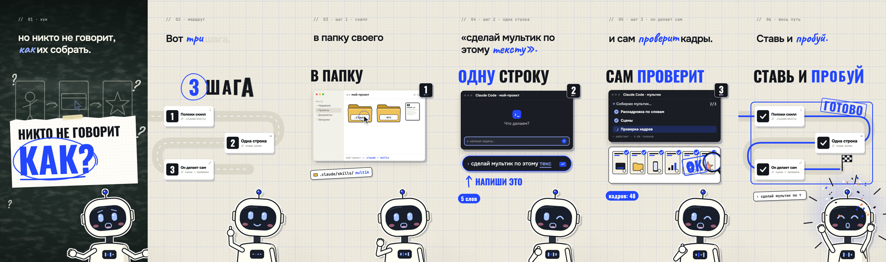
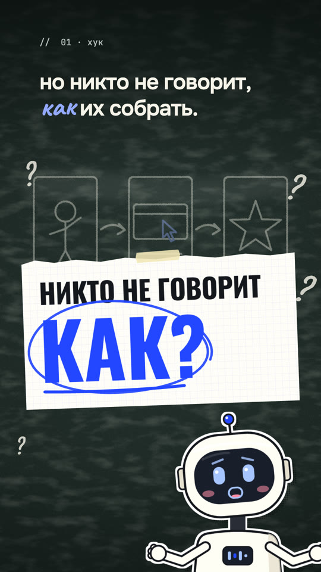
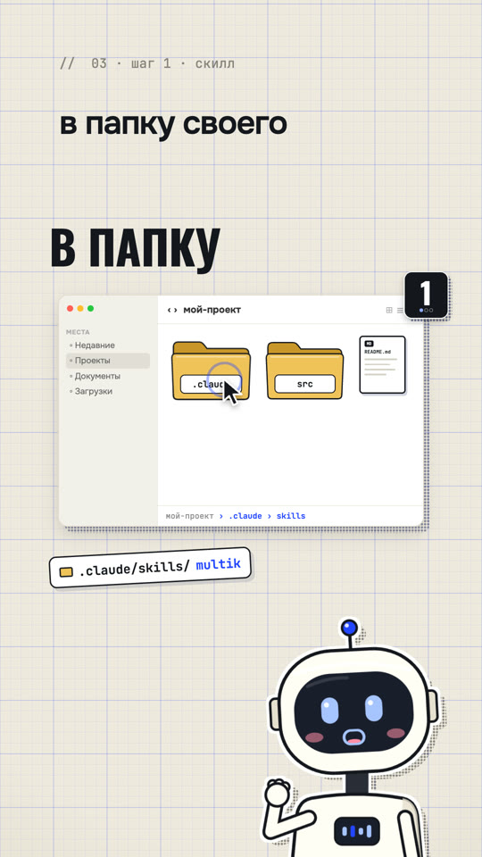
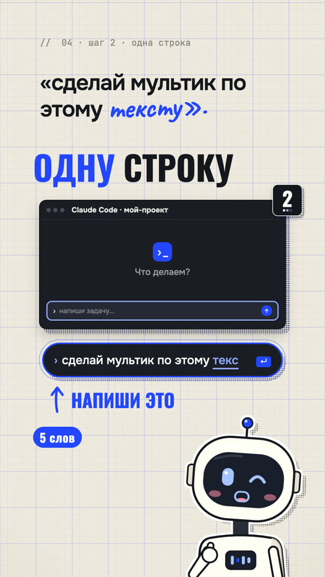
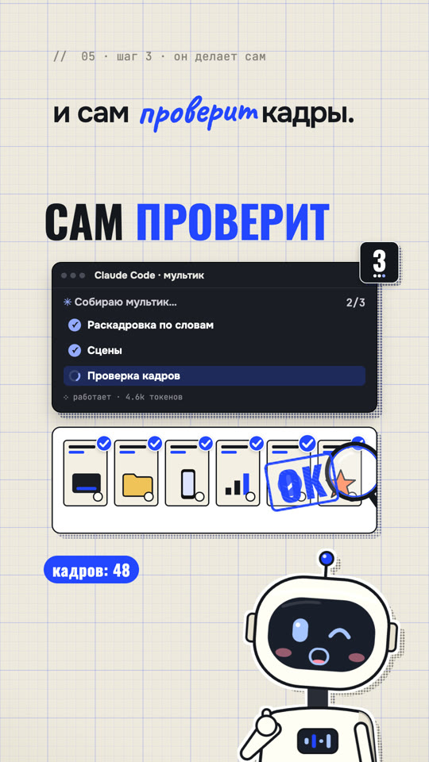
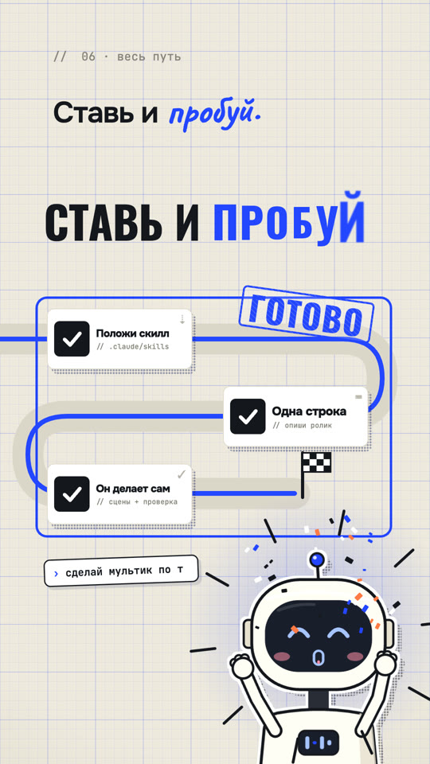
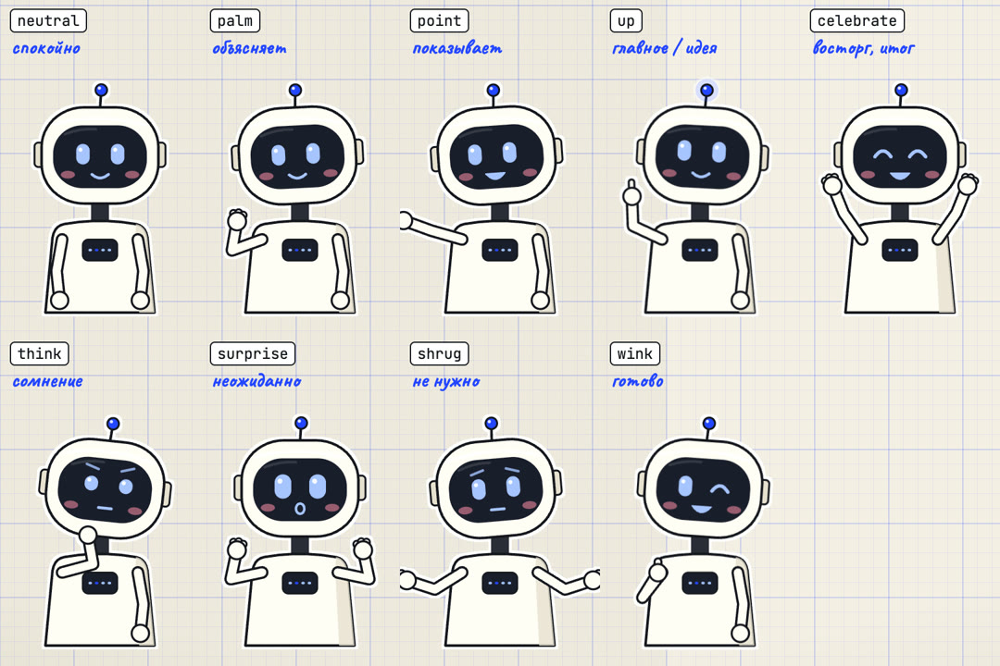

# Скилл Мультик

Скилл для [Claude Code](https://docs.claude.com/en/docs/claude-code/overview): говоришь «сделай мультик по этому тексту» — получаешь плотный объясняющий ролик 9:16. Под каждое слово что-то происходит: окна и папки нарисованы кодом, курсор кликает, плашки шагов улетают в угол, маркер обводит главное, штамп ставит «ОК», между главами — полутоновая шторка. Справа снизу весь ролик живёт герой-наклейка.



▶ [Демо-ролик, 22 секунды, со звуками событий](docs/demo.mp4)

Ничего не генерируется нейросетью-картинкой и не берётся со стоков: всё рисуется кодом на [Remotion](https://www.remotion.dev), поэтому кадры чёткие, текст точный, а правка — это строка кода, а не новый запрос.

## Как выглядит

| Хук на доске | Шаг: курсор и папка | Одна строка | Он делает сам | Финал |
|---|---|---|---|---|
|  |  |  |  |  |

Герой — Бип, векторный робот с экраном-лицом: 9 поз, рот по громкости голоса, моргает, на груди эквалайзер. Можно подставить своего героя из PNG-атласа.



## Установка

Одной командой, в папке своего проекта:

```bash
npx degit artemiimillier/skill-multik/.claude/skills/multik .claude/skills/multik
```

Или весь репозиторий целиком — с демо и примерами:

```bash
npx degit artemiimillier/skill-multik
```

Чтобы скилл был во всех проектах, положи папку `multik` в `~/.claude/skills/`. При первом ролике Claude Code сам развернёт студию `multik/` в корне проекта и поставит зависимости.

## Как пользоваться

Открой Claude Code в проекте и скажи:

- «Сделай мультик по этому тексту: …»
- «Вот ролик, сделай мультик с такой же механикой, но про …»
- «Анимируй инструкцию: как подключить …»

Claude разложит текст по словам в раскадровку, соберёт тайминги, напишет сцены, отрендерит кадры, сам посмотрит их и поправит дефекты, добавит звуки событий и выдаст MP4. Есть своя озвучка — положи файл, тайминги возьмутся из неё; нет — ролик соберётся на синтетических таймингах для черновика.

## Демо за минуту

```bash
cd .claude/skills/multik/kit
npm i
npx remotion studio src/index.ts                         # посмотреть в браузере
npx remotion render src/index.ts Demo out/demo.mp4       # 22 секунды, без звука
```

Со звуками событий: `python3 scripts/sfx.py examples/demo/props.json examples/demo/sfx.json -o public/demo-sfx.wav`, затем снова `render`.

## Что внутри

```
.claude/skills/multik/
├── SKILL.md              метод: раскадровка по словам, каталог «слово → приём», проверка, частые дефекты
└── kit/                  Remotion-проект
    ├── src/theme.ts      палитра, шрифты, сетка кадра — внешний вид меняется здесь
    ├── src/lib/          библиотека: время и пружины, рамка кадра, знаки, интерфейсы, реквизит
    ├── src/hero/         Бип, наклейка-обёртка, свой герой из PNG-атласа, лист поз
    ├── src/Film.tsx      оболочка ролика: фон, субтитр, герой, шторки, звук
    ├── examples/demo/    пример: текст, якоря, раскадровка, сцены, звуки
    └── scripts/          prep.py (тайминги), sfx.py (звуки), stills.mjs (кадры на проверку), compare.py
```

## Требования

- Claude Code.
- Node.js 18+ и `npm`. Remotion скачает headless Chrome сам.
- Python 3.9+ — только стандартная библиотека.
- `ffmpeg` — для работы с озвучкой и листов кадров.
- По желанию: `pip install faster-whisper` — распознать свою озвучку локально; `pip install pillow` — лист «образец / наш».
- Сеть при рендере: шрифты (Onest, Oswald, Caveat, JetBrains Mono) берутся из Google Fonts.

## Под себя

- **Цвет и фон** — `src/theme.ts`: акцент по умолчанию кобальт, поменяй `T.accent` — поменяются все круги, штампы и акцентные слова.
- **Шрифты** — там же, импортом из `@remotion/google-fonts`.
- **Свой герой** — нарисуй позы на одном прозрачном PNG, опиши кадры в `rig.json` (формат в `src/hero/AtlasHero.tsx`) и передай `hero={atlasHero(rig)}` в `<Film>`.

## Лицензия

Код — MIT, см. [LICENSE](LICENSE). Remotion распространяется по [своей лицензии](https://www.remotion.dev/license): бесплатно для частных лиц, некоммерческих организаций и компаний до 3 человек, остальным нужна платная лицензия Remotion. Шрифты Google Fonts — SIL Open Font License.

---

**Автор — Артемий Миллер**
Каждую неделю выкладываю одно рабочее решение в Telegram-канал «Миллер про Вайб-Кодинг» — забирай бесплатно на [artimiller.ai](https://artimiller.ai).
